# Orbit & Outplay — Exoplanet Survey

A turn-based **mission-design roguelite for 1–4 players**. You run a small space agency: design a spacecraft under a fixed budget, draft one of three **real exoplanets** from the NASA Exoplanet Archive, fly a telegraphed hazard course across its surface, bring the data home, and keep the agency funded long enough to file a campaign record.

Every destination is a real planet. Every hazard is derived from its measured properties — equilibrium temperature, host-star radiation, surface gravity, distance from Earth — and the game prints the measurement next to the abstraction it drives.

<a href="https://g110.itch.io/orbit-and-outplay">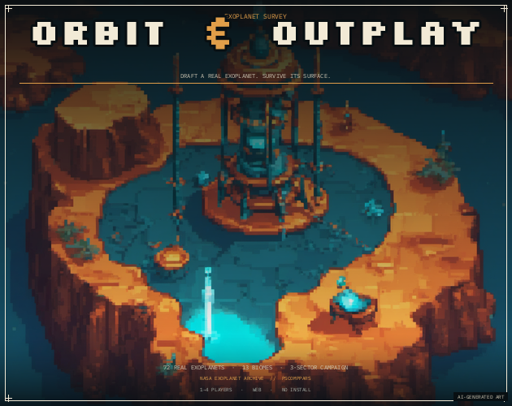</a>

**▶ Play in the browser:** https://g110.itch.io/orbit-and-outplay  
**⬇ Judged build, demo video and deck:** [release v1.0-submission](https://github.com/g1gowda123/spacegame/releases/tag/v1.0-submission)

- **Engine:** Godot 4.7.2, GDScript, GL Compatibility renderer (WebGL 2)
- **Viewport:** 640×360 logical, pixel art, nearest-neighbour filtering
- **Platform:** desktop and browser (threadless static export)
- **Run length:** 3 sectors, 10–15 minutes, 1–4 players local hot-seat

---

## At a glance

| | |
|---|---|
| **Genre** | turn-based tactical roguelite / mission-design game |
| **You do** | build a spacecraft → draft a real planet → route across its surface → refit → repeat ×3 → graded |
| **Core tension** | mass vs capability, heat vs schedule, power vs shielding, data vs downlink distance |
| **The hook** | the planet's real physics is the level design |
| **Data** | 72 curated planets from NASA Exoplanet Archive `pscomppars` (0.35–2.2 Earth radii) |
| **Content** | 13 biomes, 4 hulls, 3 launchers, 4 objectives, 6 instruments, 11 refits, 8 event cards |
| **Soundtrack** | three adaptive loops (title / sector / debrief), ducked under hazards |
| **Status** | playable end to end, native + web; submission package in `submission/` |
| **Licence / attribution** | original code + AI-generated art; NASA data under its open terms; see [Credits](#credits) |

---

## Contents

1. [At a glance](#at-a-glance)
2. [Five-minute showcase](#five-minute-showcase)
3. [What it looks like](#what-it-looks-like)
4. [What you actually do](#what-you-actually-do)
5. [A run, step by step](#a-run-step-by-step)
6. [Mission design](#mission-design)
7. [Surface operations](#surface-operations)
8. [Crew, difficulty and daily runs](#crew-difficulty-and-daily-runs)
9. [Debrief and refit](#debrief-and-refit)
10. [Scoring](#scoring)
11. [Where the science comes from](#where-the-science-comes-from)
12. [Controls](#controls)
13. [Running the project](#running-the-project)
14. [How it is built](#how-it-is-built)
15. [The surface generator](#the-surface-generator)
16. [Art pipeline](#art-pipeline)
17. [Repository layout](#repository-layout)
18. [Licence](#licence)
19. [Credits](#credits)

---

## Five-minute showcase

**The five-minute story:** problem → product → live demo → brief match → NASA data → submission compliance.

### 1. The problem (30 seconds)

Designing a space mission is a chain of coupled trade-offs: mass against capability, power against instruments, thermal control against schedule, data volume against distance. A form or a lecture teaches the vocabulary but not the tension — a student can memorise "delta-v" and still never feel it run out.

**Who it helps:** classrooms, museums and outreach programmes that need a real mission-design lesson in one sitting. Free, browser-only, no account.

### 2. What we built (45 seconds)

**Orbit & Outplay** is a turn-based **mission-design roguelite**. Under a fixed $500M budget you:

1. **Design a spacecraft** — hull, launch vehicle, orbit, science objective, exactly two instruments, validated against budget and fairing mass.
2. **Draft one of three real exoplanets** — each card shows the measured archive values next to the mission bars they generate.
3. **Fly its surface** — one committed move per turn, telegraphed hazards, limited hull, heat, fuel, power and time.
4. **Refit and repeat** — three planets, then a graded agency ledger.

Browser, 640×360 pixel art, **10–15 minutes**, 1–4 players local hot-seat, no install.

**The design promise in one line:** every number is a decision, and every loss is explainable.

### 3. The 5-minute demo path

Newest code: `godot --path /home/g1/godot/nasa`. Packaged build: run `tools/play_web.sh` (serves `build/web` on `http://127.0.0.1:8061/index.html`). If the port is busy, pass another one: `tools/play_web.sh 8062`.

| Time | Screen | What you show | What you say |
|---|---|---|---|
| 0:00 | Title | press **Begin Mission** | "One run, three real planets, about twelve minutes." |
| 0:20 | Mission design | swap a hull, watch the six bars reprice, pick an illegal loadout | "The budget is a hard wall — the launch button locks." |
| 1:00 | Target draft | read `Teq`, gravity and distance off a card; take the harsh world | "These are archive measurements; the hazard bars are our published formulas." |
| 1:40 | Architecture review | transfer arc, four segments, CML, ConOps | "This is the NASA mission-design framework, made playable." |
| 2:10 | Surface | hover a tile, commit, watch the telegraph resolve, collect, `HOLD`, `EXTRACT` | "One move per turn; the hazard is shown before it lands." |
| 3:40 | Debrief | science, grant, approval, buy one module | "The consequence of this route is the next mission's budget." |
| 4:10 | Report | grade, ledger, campaign code | "One screen where the science and the score are the same thing." |
| 4:40 | Close | back to title | "Next: classroom mode and a codex linking every number to its archive row." |

Backup if the demo machine is slow: `demo/orbit_outplay_demo.mp4` (29.6 s) and `demo/orbit_outplay_deck.pdf` (exactly 7 slides).

### 4. How it matches the challenge brief

The 2026 brief: *"Create a game where players design, run and simulate a full space mission, trading off objectives, instruments, launch vehicle, budget, power, mass and communications."*

| Brief requirement | Where it lives in the game |
|---|---|
| Design a mission objective and requirements | Four objectives set the data quota and the instrument fit |
| Design a spacecraft | Four hulls, six instruments (pick exactly two), live mass/power/thermal/data bars |
| Select launch vehicle and orbit | Three launchers with fairing capacity; LOW/POLAR/HIGH profiles with period, eclipse and passes/day |
| Manage budget, mass, power, communications, data, lifetime | Hard $500M and mass checks; per-move Δv, heat and power; downlink loss by distance; sols as the clock |
| Run and simulate a complete mission | Design → launch → transfer → surface ops → downlink → end of mission, gated by the architecture review |
| Evaluate how choices shape mission success | Three-sector campaign, refit economy, approval track, final C–S grade |
| Feedback and educational explanation | Path preview, damage toasts, debrief ledger, CML and segment readouts on the report |
| Multiple scenarios | 72 real planets, 13 biomes, survey and relay sectors, seeded events |
| Team play (optional) | 1–4 players hot-seat, conflicting role goals, shared campaign code |
| Save, share, compare | Campaign code `OO-…` reproduces the same worlds and loadout; copy with `C` |

Full trace, one row per line of the brief: [`docs/SUBMISSION.md`](docs/SUBMISSION.md).

### 5. How it scores on the judging criteria

The 2026 rubric: **Impact, Creativity, Validity, Relevance, Presentation**.

| Criterion | Our answer | Proof |
|---|---|---|
| **Impact** | A full mission-design lesson in one 10–15 minute session; free, browser-only, no account, works on a school laptop. | playable build, `build/web/` |
| **Creativity** | The planet's real physics is the level design: temperature sets heat per move, gravity sets fuel cost, distance sets data loss. | draft cards, hazard table, sector |
| **Validity** | Real `pscomppars` rows; every derived number has a formula; abstractions are labelled as abstractions; dataset and builder ship in the repo. | `data/exoplanets.json`, `tools/build_exoplanets.py` |
| **Relevance** | Answers the *Space Mission Design Game* brief end to end, with NASA data as the core mechanic, not decoration. | [brief match](#4-how-it-matches-the-challenge-brief) |
| **Presentation** | 30 s video, 7-slide deck, project page, and a final report that reads like a real mission ledger. | `demo/`, `docs/DECK_NOTES.md` |

### 6. NASA data and resources — what we use, and where

**Say this in 20 seconds:** *the NASA Exoplanet Archive gives us the planets, the challenge brief gives us the mission, and NASA's mission-design resources give us the language and the readouts. Every number the player sees traces back to a real archive row or a published design method.*

| NASA resource | What we take from it | Where the player sees it | Proof in the repo |
|---|---|---|---|
| **Exoplanet Archive — Planetary Systems Composite Parameters (`pscomppars`)** | 72 real planets: equilibrium temperature, mass/radius, insolation, distance, host star | Draft cards (measured line + five hazard bars); per-move heat, Δv cost and downlink loss in a sector | `data/pscomppars_raw.csv`, `data/exoplanets.json`, `tools/build_exoplanets.py` |
| **Space Apps 2026 — *Space Mission Design Game* brief** | The requirements the game must cover | Design → review → surface run → report | `docs/SUBMISSION.md` |
| **Design and Develop Science Missions** | The four mission segments: launch, space, ground, user | Design grouping; `SEGMENTS` line on the report | `scripts/report.gd` |
| **General Mission Analysis Tool (GMAT)** | Orbit as real quantities: altitude, period, eclipse fraction, passes/day | Orbit choice on the design screen; `ORBIT` readout on the report | `scripts/game_state.gd` |
| **Concept Maturity Levels (CML)** | Design maturity 1–4 from mass margin, power margin and science traceability | Design validation line; review gate; `CONCEPT` line on the report | `scripts/game_state.gd`, `scripts/design.gd` |
| **Mission Design Lab (MDL)** | Trade study first, point design second | Design screen is the trade study; the between-sector refit is the point design | `scenes/design.tscn`, `scenes/debrief.tscn` |
| **NASA Mission Viz** | Earth-to-target transfer arc and mission timeline | Mission Architecture Review, before the target is committed | `scripts/draft.gd` |
| **Visualize a Space Mission Using Virtual Reality (2023)** | Concept, trajectory and timeline in one view (we do it in 2D, not VR) | Six-stage ConOps timeline on the review screen | `scripts/draft.gd` |
| **A Learning Game About Telescopes** | Instruments should answer the science question | `SCIENCE FIT +10%` when the payload matches the objective | `scripts/game_state.gd` |
| **CubeSat 101** | A compressed ConOps with mass, power, thermal, data and budget lines | The whole run: design → launch → surface ops → downlink → end of mission | final report |
| **CSA digital games and activities** | Short, readable, pick-up-and-play browser games | 640×360, 10–15 minute run, mouse/touch, no install | `project.godot`, `build/web/` |
| **Chen & Kipping (2017)** *(external paper, not NASA)* | Mass–radius relation for missing or implausible masses | Flagged `mass_est: true` in `data/exoplanets.json`; the raw archive CSV is unchanged | `tools/build_exoplanets.py` |

**What we do not use:** no NASA logos, flags, mission identifiers or NASA imagery — the event name appears only as plain text. All in-game art is original, AI-generated art, disclosed in [Credits](#credits).

### 7. Mandatory submission checklist

| Requirement | Status |
|---|---|
| Project name, summary, description | written — `docs/SUBMISSION.md` |
| Demo: ≤30 s video **or** ≤7-slide deck | both exist — `demo/orbit_outplay_demo.mp4` (29.6 s), `demo/orbit_outplay_deck.pdf` (7 slides) |
| Public demo link, no password | upload before submitting |
| Public final-project link | host `build/web/` or upload `submission/orbit_outplay_web.zip` |
| NASA data used and named | PSCompPars, cited in the repo and on the page |
| References for every source | `docs/SUBMISSION.md` reference list |
| Super Intelligence (AI) disclosure | in [Credits](#credits) and the project-page field |
| English throughout | yes |
| No NASA logos, branding or imagery | checked — event name as plain text only |
| No under-18 names, voices or likeness | checked |
| Submitted before 15 Nov 23:59 local | **to do** |

### 8. If the mentor asks (Q&A crib)

- **"Is the science real?"** Every target is a `pscomppars` row. Derived numbers use documented formulas, and the game prints the abstraction next to the measurement.
- **"Is the trajectory real?"** No. Orbit is a profile (altitude, period, eclipse, passes/day) and transfer time is a labelled c-fraction abstraction. The screen says so.
- **"Leaderboard?"** Local best and daily best only. No server, no account — deliberate, so it runs anywhere.
- **"Did AI make it?"** Yes, and it is disclosed: art generated by the user in ComfyUI, code written with AI assistance and reviewed by the team.
- **"What is missing?"** A soundtrack; the new UI kit is only partly integrated; some terrain still reads tiled at 2×. Each has an owner and a plan.
- **"What next?"** Classroom mode with printable design worksheets, a codex linking every number to its archive row, and networked co-op.
### The gameplay loop, as a flowchart

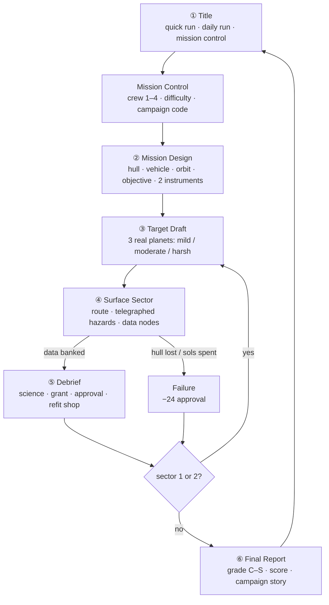

Inside a sector, the loop is one committed move per turn:

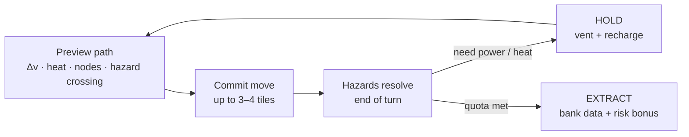

### The loop on screen

Fresh captures from the current build, numbered to match the flowchart.

| | |
|---|---|
| 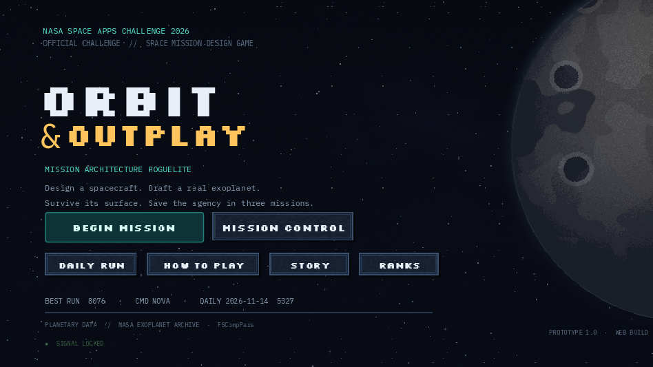 | 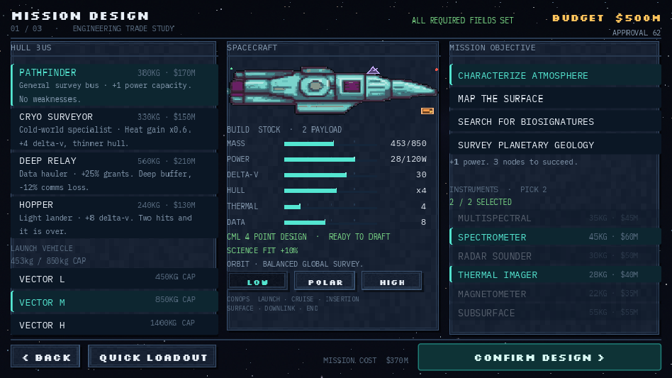 |
| **① Title.** Daily seed, best score, one obvious way in. | **② Mission design.** Six live bars; launch locks when the loadout breaks budget or fairing mass. |
| 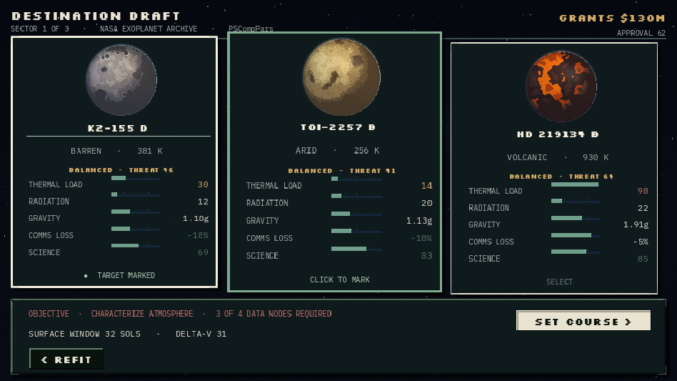 | 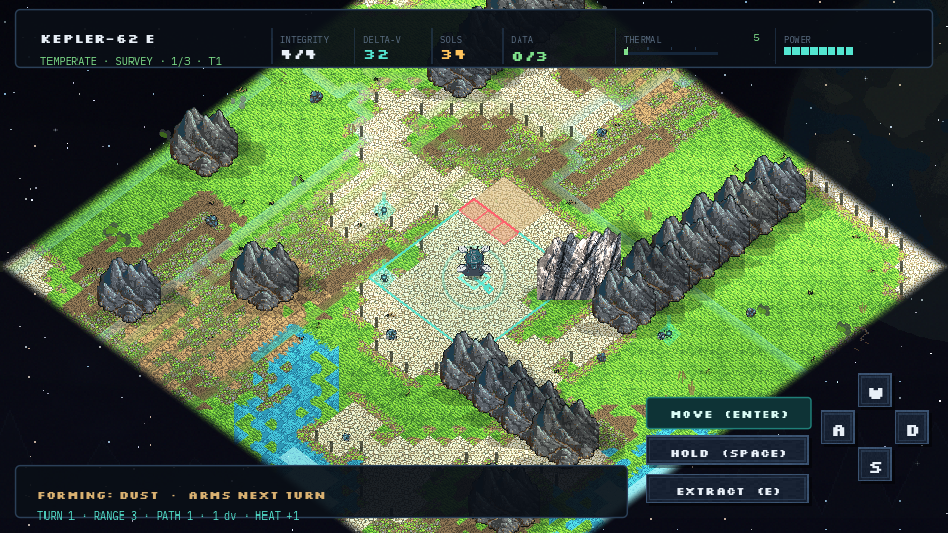 |
| **③ Target draft.** Three real planets, measured values on the card, mild/harsh tags. | **④ Surface.** Hover a tile and the game prices the move: path, Δv, heat, hazard crossing. |
| 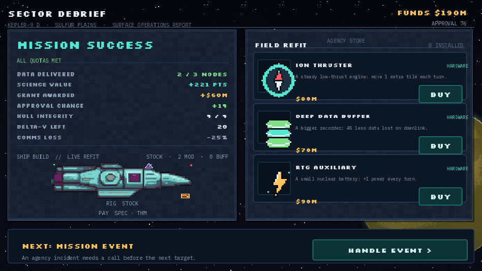 | 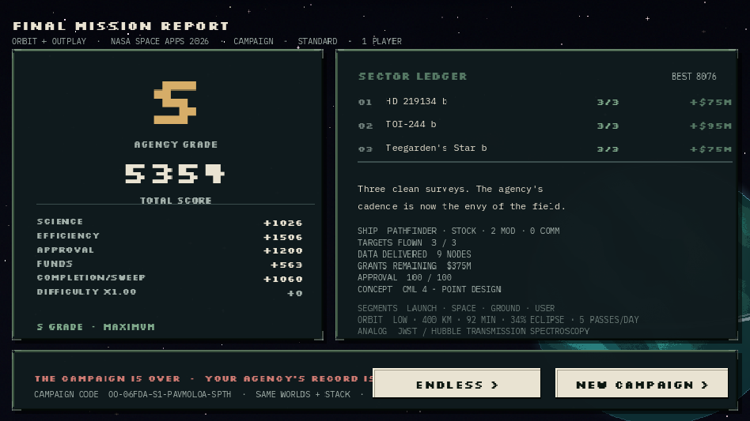 |
| **⑤ Debrief.** Science, grant, approval, and the three-offer refit shop. | **⑥ Final report.** Grade, score breakdown, sector ledger, campaign code. |

Default sector view, with survey fog on — you only see what you have scanned:

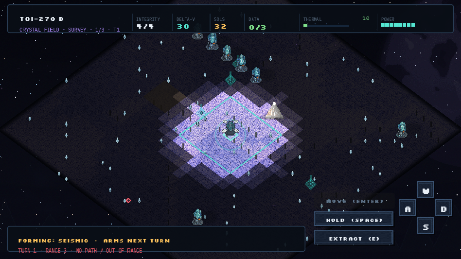

More frames: `loop_briefing.png` (story briefing), `loop_crew.png` (crew manifest), `loop_buff.png` (field commission), `loop_relay.png` (relay-survey sector).

### Newest look — what changed in this pass

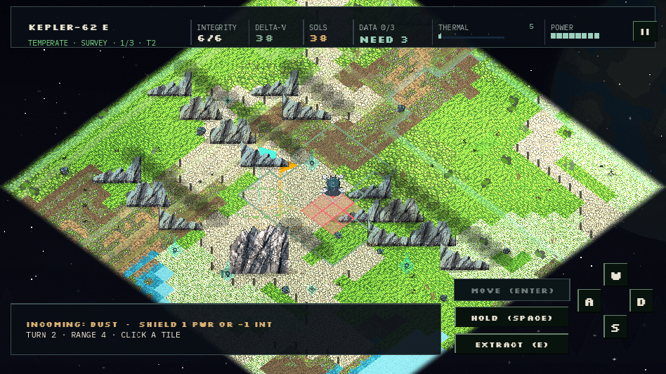

Captured from the current build (survey fog switched off here so the whole board is visible). What is new in this frame:

- **Hazard telegraphs are animated fields**, not flat squares — this one reads `INCOMING: DUST · SHIELD 1 PWR OR −1 INT`, so the player can price the hit before moving.
- **W6 hero outcrops**: one large landmark plus two or three supporting rocks per board, with scale and tint jitter, instead of a repeated stamp.
- **New console HUD**: one top telemetry strip and a physical-looking move / `HOLD` / `EXTRACT` cluster.
- **Lighting grade**: per-biome exposure, hue-only tint and a soft rolloff, so volcanic and sulfur worlds stop clipping while temperate stays readable.
- **Reachable cells** are outlined as one shape, not a grid of boxes.
## What it looks like

**In one sentence:** you design a spacecraft under a fixed budget, draft one of three real exoplanets, then keep it alive long enough to bring the data home.

| | |
|---|---|
| 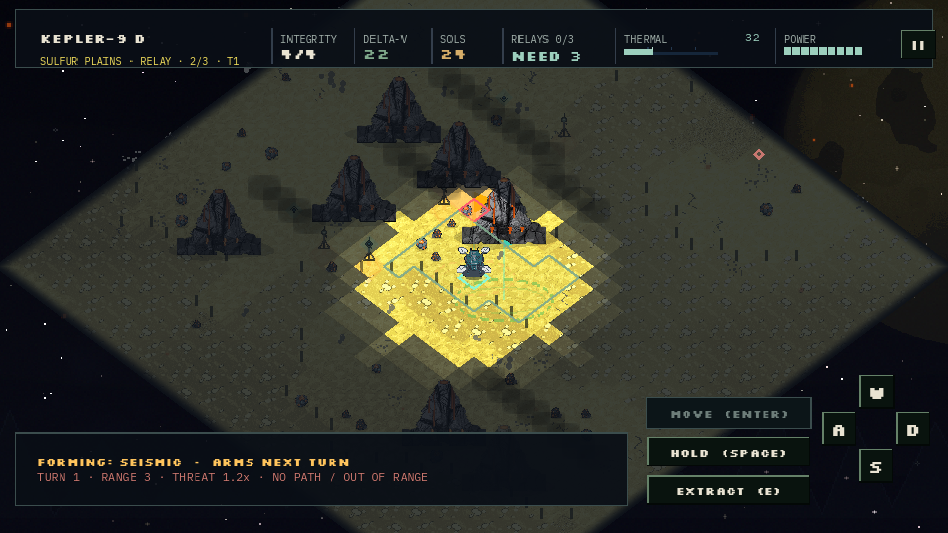 | 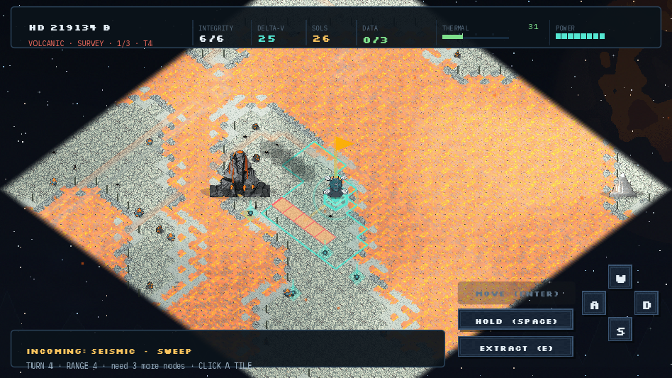 |
| **Temperate worlds.** Ridges, lakes and relay beacons — route around the terrain or pay for the shortcut. | **Volcanic worlds.** Lava fields and ash that punish a slow route. |
| 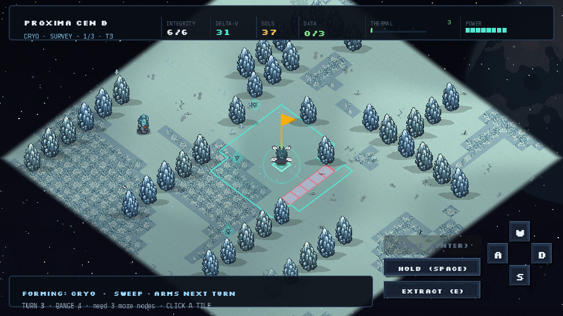 | 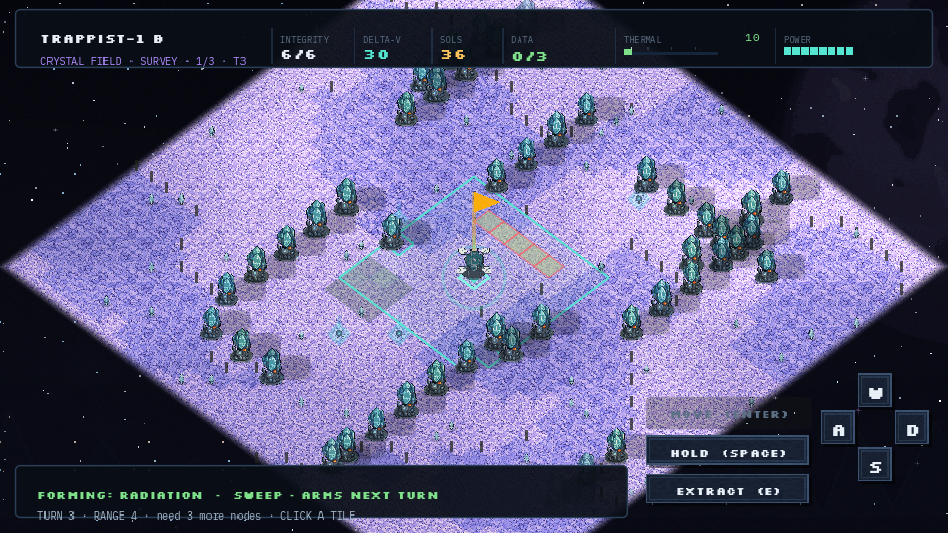 |
| **Frozen worlds.** Fractured plates, ice teeth, and very little cover. | **Crystal fields.** Spires break sightlines and eat the safe path. |

Each run is three planets. At every stop you draft one of three real archive worlds, pick a route across its surface, and decide when to spend fuel, hold position, or extract before the next hazard lands. Between planets you spend the grant on repairs, instruments, and firmware that bend the rules.

The loop is deliberately short: **build → draft → survive → refit → repeat**, three times, then a final grade. A run takes about 10–15 minutes.

### Surface variety

Every sector is drawn from a different archive world. The surface generator switches landform algorithms per biome, so an ice sheet, a volcanic caldera, a crystal field, and a cratered iron desert each ask for a different route. The current 72-planet pool is made of landable worlds; ocean, methane, obsidian, and carbon are terrain-renderer showcases outside the draft pool.

---

## What you actually do

You are not piloting a ship. You are making **engineering trade-offs under a fixed budget**, then living with them on an alien surface.

The loop asks one question over and over: *is this route worth the resources it costs?* A longer path might dodge a thermal surge but drain your delta-v. A shortcut might grab two data nodes but end with the hull on fire. There is no combat AI — the opponent is your own resource budget.

Three ideas hold the design together:

- **Telegraphed hazards, not surprise damage.** Every threat is shown one turn before it resolves. A loss is always explainable: you knew what was coming and chose the route anyway.
- **Real measurements, honest abstraction.** The archive does not publish "heat per move". The game derives a stable, documented value from equilibrium temperature, gravity, insolation, stellar age, and distance — and shows the raw measurement on the card so you can see the abstraction.
- **One screen per decision.** Title → design → draft → surface → debrief → report. No hidden menus, so a run can be demoed in 30 seconds and understood in a few minutes.

---

## A run, step by step

| Phase | What happens | What you decide |
|---|---|---|
| **Title** | Starfield, ringed planet, best score, daily best, How to Play overlay | Quick run, daily run, or Mission Control |
| **Mission Control** | Campaign or Daily, crew size 1–4, difficulty tier, campaign-code entry | Who is flying and at what difficulty |
| **Mission design** | Pick a hull, launch vehicle, orbit, science objective, and exactly two instruments | What kind of mission this is |
| **Target draft** | Three real exoplanets are drawn from the archive, each with measured properties and five derived mission bars (thermal, radiation, gravity, comms, science), plus a SAFE / BALANCED / HARSH threat tag | Which world to risk |
| **Architecture review** | Transfer arc, the four NASA mission segments, CML, and a launch-to-end ConOps timeline | Commit the architecture |
| **Surface sector** | One move per turn across a chunked alien landscape; hazards telegraph (including a faint FORMING pre-state), then resolve at end of turn | Route, when to hold, when to extract |
| **Debrief** | Success/failure review, data delivered, science, grant, approval change, three-offer refit shop, and one seeded incident with two trade-offs | What to spend the grant on, and which incident risk to accept |
| **Final report** | Grade C–S, score breakdown, next-grade gap, sector ledger, role goals, narrative, educational notes | Whether to run again |

The draft is deliberately weighted: one **mild**, one **moderate**, and one **harsh** destination, with distinct biomes, so every choice is a real risk/reward decision.

Approval starts at **62 on Standard** (72 on Cadet, 52 on Director). A successful sector is worth **8 + 2 per data node collected**; a failed one costs **−24**. If approval hits zero, the agency is defunded and the run ends early — even in sector one.

---

## Mission design

### Budget and mass

- **Budget:** $500M, covering hull, launch vehicle, instruments, and the mission itself.
- **Fairing capacity:** the launch vehicle sets a hard mass ceiling in kilograms.
- Getting the design wrong is not a soft warning: the launch button stays locked until the loadout is valid.
- There is a conservative default loadout (Pathfinder / Vector M / Low orbit / Characterize Atmosphere / Spectrometer + Thermal Imager) so a new player can launch immediately.

### Hulls

| Hull | Class | Mass | Cost | Power | Δv | Integrity | Data | Thermal res. | Move range | Perk |
|---|---|---|---|---|---|---|---|---|---|---|
| **Pathfinder** | General survey bus | 380 kg | $170M | 120 | 30 | 4 | 8 | 4 | 3 | +1 power capacity, no weaknesses |
| **Cryo Surveyor** | Cold-world specialist | 330 kg | $150M | 100 | 34 | 3 | 7 | 12 | 3 | Heat gain ×0.6, thinner hull |
| **Deep Relay** | Data hauler | 560 kg | $210M | 170 | 26 | 4 | 14 | 5 | 3 | +25% grants, −12% comms loss |
| **Hopper** | Light lander | 240 kg | $130M | 80 | 38 | 2 | 6 | 2 | 4 | +8 Δv, two hits and it is over |

### Launch vehicles and orbits

| Vehicle | Cost | Capacity | Note |
|---|---|---|---|
| **Vector L** | $55M | 450 kg | Cheap, tight margin; cannot lift the Deep Relay |
| **Vector M** | $100M | 850 kg | The safe middle |
| **Vector H** | $190M | 1,400 kg | Expensive, room for anything |

Orbit is a mission-profile multiplier rather than a separate orbit-mechanics sim:

| Orbit | Effect |
|---|---|
| **Low** | Balanced, no modifier |
| **Polar** | +15% science, +10% heat per tile |
| **High** | −15% heat per tile, −10% science |

### Objectives

| Objective | Quota | Bonus | Perk |
|---|---|---|---|
| **Characterize Atmosphere** | 3 nodes | +1 power cap | The safest quota |
| **Map the Surface** | 4 nodes | +3 Δv | Needs every node |
| **Search for Biosignatures** | 3 nodes | +1 integrity | Double science on temperate worlds |
| **Survey Planetary Geology** | 3 nodes | — | +25% grants on rocky worlds |

### Instruments (pick exactly two)

| Instrument | Mass | Cost | Power | Effect |
|---|---|---|---|---|
| **Multispectral Camera** | 35 kg | $45M | 12 | +10% science |
| **Spectrometer** | 45 kg | $60M | 18 | +20% science |
| **Radar Sounder** | 30 kg | $50M | 14 | Hazard shielding costs 0 power |
| **Thermal Imager** | 28 kg | $40M | 10 | Heat gain ×0.7 |
| **Magnetometer** | 22 kg | $35M | 8 | +1 power regeneration per turn |
| **Subsurface Drill** | 55 kg | $55M | 16 | Bonus data on rock worlds (arid, barren, volcanic) |

Derived ship stats update live in six telemetry bars: **mass, power, delta-v, hull integrity, thermal margin, and data capacity**. Power regeneration is `1 + instrument bonuses`, plus 1 for a hull generating 150+ power, minus 1 if instrument draw reaches 36.

---

## Surface operations

The surface is one sector of a planet: a chunked 16×16-cell world streamed from a fixed seed, rendered isometrically at the 640×360 logical resolution. Around the map sit the HUD, a route readout, a D-pad, and the three action buttons.

### Resources

| Resource | What it represents | How it changes |
|---|---|---|
| **Integrity** | Structural health | −1 to −2 per hazard hit; zero ends the sector |
| **Thermal** | Heat load | Every path tile adds heat; HOLD vents it; overheating costs integrity |
| **Δv** | Remaining propellant | Each tile moved and some hazards spend it |
| **Power** | Shielding and systems | Regenerates each turn; blocking a hazard costs power |
| **Sols** | Mission clock | One per tile moved (or one HOLD); the sector fails when it runs out |
| **Data** | Collected science nodes | Collect the quota, return to the cyan extraction pad, then press **EXTRACT**; a full 4/4 sweep does **not** auto-complete the sector |

### The movement rule

Each turn allows **one committed move** of up to 3 tiles (4 in the Hopper, +1 with the Ion Thruster). Moving the cursor over a reachable cell draws the full path and previews its **Δv cost, heat load, node count, and whether the path crosses a hazard**; every tile on that path spends 1 Δv and 1 sol, so a three-tile move costs three of each. Commit the move, then the hazard spawned for this turn resolves at the **end** of the turn. Once the quota is met, return to the cyan extraction pad and press **EXTRACT** to bank the data. The cyan-pad return is the second half of the route plan, not a formality; a full 4/4 sweep still requires the trip home.

That single rule is what makes the sector a route-planning problem rather than a walking simulator: you cannot creep forward one tile at a time, and you cannot see the next threat until you have spent this turn's move.

### Actions

| Action | Key | Effect |
|---|---|---|
| **Move** | `ENTER` / click the tile again | Commit the previewed path |
| **Hold** | `SPACE` | Stay put, vent heat, regenerate power, spend a sol |
| **Extract** | `E` | Leave the surface; data is banked |
| **Grid** | `G` | Toggle the tile grid overlay |

### Hazards

Hazards are drawn from the planet's physics and are biased toward uncollected data nodes, so the greedy grab is always the risky one. Blockable hazards can be absorbed with power; unblockable ones must be routed around or eaten. Hazards resolve at the **end** of the turn, not when you step on them.

The hazard set **ramps with the mission**: one threat at turn 1, a second from turn 3, a third from turn 6 (or from turn 4 in sectors 2–3). Footprints vary between 3×3 blocks, crosses, diamonds, and five-tile lines. A line marked **SWEEP** moves one tile per turn for four turns, with an arrow showing where it will be next; it can chase you across the map. Damaged ground leaves a visible scar for four turns.

| Hazard | Blockable | Integrity | Thermal | Δv | Other |
|---|---|---|---|---|---|
| **Stellar Flare** | yes | −1 | +8 | — | — |
| **Thermal Surge** | yes | — | +24 | — | — |
| **Dust Storm** | yes | −1 | — | −1 | — |
| **Seismic Shock** | no | −1 | — | — | — |
| **Radiation Belt** | yes | −1 | +5 | — | — |
| **Eclipse Shadow** | no | — | −16 | — | Restores 2 power |
| **Cryo Quake** | no | −1 | — | −1 | — |
| **Solar Wind Front** | yes | — | +15 | −1 | Sweeps in a line |
| **Meteor Shower** | no | −2 | +4 | — | Heavy impact |

The **Radar Sounder** makes blocking free, the **Thermal Imager** cuts heat gain, and the **Magnetometer** speeds power regeneration — the three direct counters to the three ways a sector kills you.

### Sector maths

At the start of a sector, the planet's measured values are converted into run constraints:

- `Δv = round(planet Δv × ship Δv / 30)`
- `sols = max(18, planet sols − 2 × (sector − 1))`
- `heat per move = round(planet heat × 0.11) − thermal resistance`, then hull, orbit, and instrument multipliers, clamped **1–18**
- `comms loss = planet comms loss − hull/instrument bonus`, clamped **0–40%**
- `power cap = 4 + floor(power generation / 40)`, +1 for the atmosphere objective, +1 per later sector

---

## Crew, difficulty and daily runs

Mission Control is the run-shape screen between the title and mission design. It is optional: **Begin Mission** on the title starts a solo Standard run immediately.

### Crew mode (1–4 players, local hot-seat)

Choose 2–4 players and each gets one or two roles. Before every decision phase the game shows a handoff banner naming whose call it is.

| Role | Buff | Personal goal (worth +180) |
|---|---|---|
| **Flight Director** | +$30M starting budget | Finish with approval 60+ |
| **Science Lead** | +10% science all run | Deliver 9 data nodes |
| **Flight Dynamics** | +3 delta-v every sector | Finish with 12+ delta-v left |
| **Field Commander** | +1 integrity every sector | All three sectors successful |

The goals conflict on purpose: more nodes cost fuel and heat, safe extraction starves the science goal, and a risky route threatens the field commander's clean sheet. The final report records how many role goals the crew met.

### Difficulty tiers

| Tier | Budget | Approval | Hazard fronts | Heat per tile | Score |
|---|---|---|---|---|---|
| **Cadet** | +$100M | +10 | −1 | −1 | ×0.90 |
| **Standard** | — | — | — | — | ×1.00 |
| **Director** | −$75M | −10 | +1 | +1 | ×1.25 |

Every modifier is printed on the difficulty card before the run. The multiplier is a separate row in the final score breakdown.

### Daily Challenge and campaign codes

The **Daily Run** uses a date-derived seed, so everyone gets the same three exoplanets for that day; the title shows the player's daily best. The final report prints a campaign code: `OO-0F7A5-S1` (seed, difficulty, crew size) or `OO-0F7A5-S1-PAVMOLOA-SPTH` once a design is committed (adds hull, vehicle, orbit, objective and both instruments). Press `C` to copy it; paste it into Mission Control to fly the same worlds, or the exact same stack, and compare results.

---

## Debrief and refit

After every sector you get a result screen and a **three-offer refit shop**. Modules stack, so a run becomes a build — and the ship portrait in the debrief changes **immediately** as each module is bolted on. Payload instruments and refit hardware share one slot map, so the silhouette tells the run's story at a glance. The build tier climbs STOCK → FIELD-READY → SURVEY-RIGGED → DEEP-SPACE → FLAGSHIP, and the final report prints the completed ship. The visual layer is cosmetic on purpose: every stat still comes from `GameState.ship()` and `begin_sector()`, so the picture cannot lie about the numbers.

| Module | Cost | Kind | Effect |
|---|---|---|---|
| **Rw-4 Gyrodyne** | $75M | Module | +4 delta-v every sector. |
| **Rw-8 Gyrodyne** | $120M | Module | +4 delta-v, +1 range. |
| **Hall H9** | $80M | Module | +1 tile movement range. |
| **Hall H12** | $125M | Module | +1 range, +2 delta-v. |
| **Mmrtg-140** | $90M | Module | +1 power regeneration. |
| **Mmrtg-280** | $130M | Module | +1 power, +2 heat resistance. |
| **Rfc-2 Cell** | $70M | Module | +1 power, +2 data buffer. |
| **Rfc-4 Cell** | $110M | Module | +1 power, +2 data, +2 comms. |
| **Lhp-2 Loop** | $85M | Module | Heat gain -3 per move. |
| **Lhp-4 Loop** | $125M | Module | Heat gain -3, +1 power. |
| **Cryo Loop** | $75M | Firmware | Venting also restores 1 power. |
| **Cryo Loop Ii** | $115M | Firmware | +1 vent power, +2 heat res. |
| **Whipple Mk-I** | $80M | Module | +2 maximum integrity. |
| **Whipple Mk-Ii** | $120M | Module | +2 maximum integrity. |
| **Composite Shell** | $65M | Module | +1 hull, +1 heat resistance. |
| **Composite Mk-Ii** | $105M | Module | +2 maximum integrity. |
| **X-Band Hga** | $100M | Module | Comms loss -10%. |
| **Ka-Band Dsn** | $130M | Module | Comms loss -8%, +2 data. |
| **Ssr-4 Recorder** | $70M | Module | +4 data buffer, -4% comms loss. |
| **Ssr-8 Recorder** | $110M | Module | +4 data, -4% comms loss. |
| **Mass Spec Lab** | $95M | Firmware | +15% science value. |
| **Lab Mk-Ii** | $130M | Firmware | +15% science, +2 data. |
| **Multi-Sensor Bay** | $70M | Firmware | +8% science, +2 data. |
| **Sensor Bay Ii** | $105M | Firmware | +12% science, +2 data. |
| **Contract Rider** | $90M | Firmware | +30% grant from every sector. |
| **Field Kit** | $60M | Module | Restore 2 integrity next sector. |

Grants are `(30 + 15 × delivered data) × grant multiplier`, plus $20M for a full four-node sweep and a further 1.25× for geology objectives on rocky worlds. The higher module prices mean a shop visit is a choice, not a clearance sale.

### Field commissions

After planets 1 and 2, a **free** milestone draft appears before the next target: three commission cards, one pick, no grant spent. It is deliberately separate from the paid refit shop — the shop is procurement, the commission is the agency's reward. Twelve cards cover power, hull, heat, delta-v, comms, science, grants, range, hazard shielding, data, score and sector repairs. The card screen is `scenes/buff.tscn`; it is the first screen in the new UI identity pass (`docs/UI_REDESIGN.md`).

---

## Scoring

Final score is a weighted sum, not a single survival check:

| Component | Formula |
|---|---|
| Science | Σ `planet science × ship science multiplier × delivered nodes` |
| Efficiency | Σ `(Δv left × 8) + (integrity left × 55)` on successful sectors |
| Approval | final approval × 12 |
| Funds | remaining budget × 1.5 |
| Completion | 220 per successful sector |
| All-success bonus | +400 for 3/3 |

| Grade | Score |
|---|---|
| **S** | ≥ 5,200 |
| **A** | ≥ 4,000 |
| **B** | ≥ 2,800 |
| **C** | below 2,800 |

This is why the game rewards **efficiency over greed**: arriving home with propellant and hull intact is worth more than a heroic data sweep that ends with a dead lander.

---

## Where the science comes from

The dataset is built from the **NASA Exoplanet Archive — Planetary Systems Composite Parameters (`pscomppars`)** table, which combines the best available parameters for each confirmed planet.

- 72 curated planets, **0.69–2.19 Earth radii** (the builder keeps 0.35–2.2 R⊕; the curated set lands inside that window, where the derived gravity values stay playable).
- 54 host stars, 52 transit and 20 radial-velocity discoveries, 4.2–4,976 light-years out.
- Raw query snapshot: `data/pscomppars_raw.csv` (5,801 rows).
- Curated game set: `data/exoplanets.json` (each entry carries both the **raw measured values** and the derived `game` block).
- Builder: `tools/build_exoplanets.py` — deterministic, so the dataset can be regenerated and diffed.
- Missing or physically implausible masses use the **Chen & Kipping (2017)** mass–radius relation and are flagged `mass_est: true`.

### Fields used

| Archive field | Game use | Unit |
|---|---|---|
| `pl_eqt` (or `pl_insol`) | Equilibrium temperature → heat load, thermal start | K |
| `pl_bmasse` / `pl_rade` | Surface gravity → Δv cost | g (9.80665 m/s²) |
| `pl_insol` | Stellar flux → radiation and science value | W/m² (Earth = 1) |
| `sy_dist` | Distance → comms loss on downlink | pc / ly |
| `st_teff`, `st_spectype` | Star colour and hazard flavour | K / spectral class |
| `pl_orbsmax`, `pl_orbper` | Dossier detail and campaign variety | AU / days |

### Derived rules

```
heat      = clamp((Teq − 140) / 8, 4, 100)
radiation = clamp(12 + 32·(star < 1 Gyr) + 16·(star < 3 Gyr)
               + 14·(Teff > 6200 K) + 8·(Teff < 3900 K)
               + 10·(insolation > 10), 10, 95)
science   = clamp(55 + 28·(180 K ≤ Teq ≤ 330 K) + 16·(radius ≤ 1.65 R⊕)
               + 8·(system ≥ 3 planets) + 6·(4200 K ≤ Teff ≤ 6800 K), 40, 120)
delta_v   = clamp(36 − 2.5·gravity_g − 0.05·heat − 0.08·radiation, 18, 36)
comms_loss = 0 / 5 / 10 / 18 / 25 % at <20 / <50 / <120 / <350 / ≥350 ly
sols      = clamp(34 − |Teq − 280| / 55, 22, 36)
```

The in-game **THERMAL**, **ΔV**, and **COMMS LOSS** values are documented gameplay abstractions, not flight dynamics. The measured archive values themselves are shown on the detail line of every draft card.

### Mission-design framework used

The challenge resource tab maps directly onto the design loop:

- **Design and Develop Science Missions** — the game shows the four mission segments explicitly: launch (vehicle), space (hull + payload), ground (downlink/comms loss), and user (science objective).
- **GMAT** — orbit choice (LOW/POLAR/HIGH) is translated into altitude, period, eclipse fraction, and passes/day; the final report prints the flown profile.
- **Concept Maturity Levels (CMLs)** — the design validation line reports CML 1 CONCEPT, 2 FEASIBILITY, 3 TRADE STUDY, or 4 POINT DESIGN from mass margin, power margin, and science traceability.
- **Mission Design Lab (MDL)** — mission design is staged as a trade study, then a point design; the between-sector refit is the redesign loop.
- **NASA Mission Viz** — the pre-commit Mission Architecture Review draws an Earth-to-target transfer arc and the final report keeps the flown orbit profile.
- **Visualize a Space Mission Using Virtual Reality (2023)** — the review screen satisfies the mission-concept, trajectory and timeline parts in 2D: launch, cruise, insertion, surface ops, downlink, end of mission.
- **A Learning Game About Telescopes** — an instrument family that matches the objective earns a **science fit +10%** bonus; a mismatched payload is legal but loses science return.
- **CubeSat 101** — the run is a compressed ConOps: design, launch, insertion, surface operations, downlink, end of mission, with mass/power/thermal/data/budget as the budget lines.
- **CSA digital games** — short browser runs, readable HUD, and explicit feedback keep the game pick-up-and-play.

Source: <https://exoplanetarchive.ipac.caltech.edu/> — NASA Exoplanet Archive, California Institute of Technology, operated under contract with NASA.

---

## Controls

| Action | Input |
|---|---|
| Move the path cursor | `WASD`, arrow keys, or the on-screen D-pad |
| Preview a route | Move the cursor onto a reachable tile |
| Commit the move | `ENTER` / **MOVE**, or click the selected tile again |
| Hold position (vent heat, recharge, end turn) | `SPACE` / **HOLD** |
| Extract from the surface | `E` / **EXTRACT** |
| Toggle grid overlay | `G` |
| Cycle map view (three-quarter / isometric / top-down) | `V` (surface sector) |
| Copy campaign code (report) | `C` |
| Open Mission Control (title) | `C` |
| Open How to Play (title screen) | `H` / **HOW TO PLAY** |
| Screenshot (development) | `F10` on map-generation screens (not wired in-sector) |
| Everything else | Mouse or touch |

The browser build is fully playable with mouse or touch. Landscape is recommended.

---

## Running the project

### Native

```bash
git clone https://github.com/g1gowda123/spacegame.git
cd spacegame
godot --path .
```

Requires **Godot 4.7.2** (the project targets the `4.7` feature set and the GL Compatibility renderer).

Useful development entry points:

```bash
# Jump straight to a screen for review
godot --path . -- --screen=design
godot --path . -- --screen=sector --capture

# Headless parse/smoke test
godot --headless --path . --quit-after 8

# Regenerate the exoplanet dataset from the raw archive CSV
python3 tools/build_exoplanets.py
```

### Web export

The project is configured for a **static, threadless WebGL 2 build**:

1. Install the Godot export templates for 4.7.2.
2. Open the project, then **Project → Export → Web → Export Project**.
3. Serve the output over HTTP (WebGL cannot load from `file://`):

```bash
tools/play_web.sh
# open http://127.0.0.1:8061/index.html
```

The export is purely static, so it also runs on GitHub Pages, itch.io, or any plain HTTP host. No server-side code, no cross-origin isolation headers required.

---

## How it is built

`GameState` is the single source of truth. Every scene reads it, mutates it through methods, and redraws when its `changed` signal fires.

| Path | Responsibility |
|---|---|
| `scenes/title.tscn`, `scripts/title.gd` | Mission terminal, how-to-play overlay, best score |
| `scenes/briefing.tscn`, `scripts/briefing.gd` | First-run agency induction and callsign |
| `scenes/crew.tscn`, `scripts/crew.gd` | Mission Control: 1–4 players, roles, difficulty, campaign code |
| `scenes/design.tscn`, `scripts/design.gd` | Hull, launch vehicle, orbit, objective, instruments, live telemetry |
| `scenes/draft.tscn`, `scripts/draft.gd` | Three-planet target draft, architecture review, ConOps |
| `scenes/launch.tscn`, `scripts/launch_cinematic.gd` | Launch sequence and transfer animation |
| `scenes/sector.tscn`, `scripts/sector.gd` | Surface sector: path planning, hazards, HUD, extraction |
| `scenes/debrief.tscn`, `scripts/debrief.gd` | Result review, refit shop, event card |
| `scenes/buff.tscn`, `scripts/buff.gd` | Field commissions (free upgrade draft) |
| `scenes/report.tscn`, `scripts/report.gd` | Campaign ledger, grade, score breakdown |
| `scripts/game_state.gd` | Run state, mission rules, economy, scoring |
| `scripts/crew_director.gd` | Player count, roles, difficulty, daily seed, share codes |
| `scripts/ui_kit.gd` | Shared pixel-UI helpers (panels, bars, labels, buttons, paper skin) |
| `scripts/ship_build.gd`, `scripts/ship_diagram.gd` | Derived ship build + live silhouette with refit layer |
| `scripts/space_backdrop.gd` | Starfield / planet backdrop renderer |
| `scripts/map_generator.gd` | Chunked terrain generator and renderer |
| `scripts/music_director.gd` | Adaptive music bed, crossfade, hazard duck |
| `scripts/post_fx.gd`, `scripts/scene_fx.gd` | Full-frame grade and scene transitions |
| `shaders/` | Backdrop, map, hazard-field and post-processing shaders |

**Scene flow.**

```text
title → briefing (first run only) → crew → design → draft → [launch] → sector
      → debrief → buff → draft … (×3) → report
```

**Autoloads** (`project.godot`): `GameState` (rules/state), `CrewDirector` (players/difficulty/codes), `SceneFX` (transitions), `MusicDirector` (music bed), `PostFX` (grade), `DevRouter` (CLI deep links), `CaptureProbe` (screenshots), `DemoDirector` / `TrailerDirector` (deterministic capture), `MCPRuntimeProbe` (editor tooling).

**State flow.** `new_run()` seeds a campaign and rolls the first draft. Design selections mutate `run`; `ship()` folds hull, vehicle, orbit, objective, instruments, and owned modules into a single derived stats dictionary. `begin_sector()` converts a planet into sector constraints. `finish_sector()` settles data delivery, science, grants, and approval. `calculate_score()` walks the history at the end.

**Rendering and scale.** All terrain is generated and drawn by `scripts/map_generator.gd` (4,416 lines): 16×16-cell chunks, per-biome archetypes, 64 px palette-locked tiles, 98 transition pairs, structures, fog of war, minimap. `scripts/sector.gd` (2,858 lines) owns the turn loop, pathfinding preview, hazards, HUD and VFX hooks. The project is ~20,400 lines of GDScript across 40+ scripts; the five largest are `map_generator.gd` (4,416), `sector.gd` (2,858), `game_state.gd` (1,874), `launch_cinematic.gd` (1,279), `draft.gd` (843).

### Data model

`data/exoplanets.json` is a two-key object: `meta` (source, URL, retrieval date, count, field list) and `planets` (72 entries). Each planet carries the **raw archive measurements** plus a derived `game` block, so every abstraction is auditable:

| Group | Fields |
|---|---|
| Identity | `id`, `name`, `star`, `star_type`, `discovered`, `method` |
| Orbit | `period_days`, `semi_major_au`, `eccentricity`, `distance_ly`, `insolation_earth` |
| Planet | `radius_earth`, `mass_earth`, `mass_est`, `eq_temp_k`, `gravity_g`, `escape_kms`, `biome` |
| Star | `star_temp_k`, `star_radius_sun`, `star_mass_sun`, `star_age_gyr`, `star_metallicity`, `system_planets` |
| Derived (`game`) | `heat`, `radiation`, `quakes`, `comms_loss`, `science`, `delta_v`, `sols` |

`mass_est: true` marks a mass derived from the Chen & Kipping (2017) mass–radius relation instead of a measured value. The formula table is in [Where the science comes from](#where-the-science-comes-from); the builder is deterministic, so the dataset can be regenerated and diffed.

### Determinism

- A campaign is defined by a seed; the **campaign code** (`OO-…`) reproduces the same planets and the same loadout.
- Terrain seed = `hash(planet.id) % 90000 + 1000 + sector × 7919` (`sector.gd::_configure_map`), so a given planet and sector always draw the same world.
- Daily runs use a date-derived seed; every player gets the same three planets that day.
- `tools/audit_reach.gd`, `audit_density.gd`, `audit_islands.gd` and `water_probe.gd` are headless audits; `tools/browser_loop.mjs` drives the web build and fails unless it reaches the report.

### Commands

```bash
godot --path .                                  # run the newest code
godot --headless --path . --quit-after 8        # parse/runtime smoke test
godot --headless --path . -- --screen=flowtest  # simulate a full campaign
godot --path . -- --screen=sector --capture     # deep link + screenshot
godot --headless --path . --script tools/audit_reach.gd
python3 tools/build_exoplanets.py               # rebuild the dataset
bash tools/release.sh                           # export + package + smoke + sha256
cd build/web && python3 -m http.server 8060     # serve the web build
```

### Invariants

1. **640×360 logical viewport**, `stretch/aspect = keep`, nearest filtering — the pixel-art look is the product.
2. **No server, no account, no runtime dependency**; the web build is a static threadless export.
3. **Every derived number must trace to an archive field and a documented formula**; never invent a measurement.
4. **Every hazard is telegraphed one turn before it resolves**; a loss must be explainable.
5. **Palette-locked art** per biome (`tools/palettes.json`); tiles 64×64, structures 128/192.
6. **Determinism**: same seed → same map, same draft, same code round-trip.

### Where to change what

| If you need to change… | Look at |
|---|---|
| mission rules, economy, scoring, state | `scripts/game_state.gd` |
| one screen's layout/copy | `scenes/<name>.tscn` + `scripts/<name>.gd` |
| terrain, biomes, structures, fog | `scripts/map_generator.gd` |
| turn loop, path preview, hazards, HUD | `scripts/sector.gd` |
| ship silhouette and live refit layer | `scripts/ship_build.gd`, `scripts/ship_diagram.gd` |
| NASA dataset or derived values | `tools/build_exoplanets.py`, `data/exoplanets.json` |
| art generation pipeline | `tools/gen_asset.py`, `tools/pixelize.py`, `docs/ART_PIPELINE.md` |
| export, packaging, release checks | `tools/release.sh`, `tools/browser_loop.mjs` |

### Known limitations

- Orbit is a **profile** (altitude, period, eclipse, passes/day), not a propagated trajectory; transfer time is a labelled c-fraction abstraction.
- Scores are local (best + daily). There is no online leaderboard.
- The map is procedural pixel art; at 2× some per-cell composition artifacts remain.
- The soundtrack is adaptive but small (three cues); sound design is intentionally minimal.

### Glossary

`PSCompPars` — NASA Exoplanet Archive Planetary Systems Composite Parameters table · `CML` — Concept Maturity Level 1–4 · `ConOps` — concept of operations · `Δv` — delta-v, the fuel budget per move · `SOL` — one mission sol (turn) · `EXTRACT` — bank data and end the sector · `HOLD` — vent heat and recharge · `RELAY` — second sector type: plant three beacons instead of collecting nodes.

Nothing is persisted except the local best score (`user://orbit_save.cfg`). Runs are short by design.

---

## The surface generator

The sector renderer is the largest system in the project and the reason the game looks like a place rather than a board.

- **Chunked streaming:** 16×16-cell chunks, only the visible window is drawn.
- **13 terrain biomes:** temperate, arid, cryo, volcanic, ocean, barren, methane lakes, iron desert, sulfur plains, crystal field, obsidian glass, ammonia ice, carbon world. Nine are landable in the current planet pool (temperate, arid, cryo, volcanic, barren, iron, sulfur, crystal, ammonia); ocean, methane, obsidian, and carbon are generator set-pieces that no curated planet currently selects. Each biome declares its own generator archetype — continents, dunes, fractured ice, caldera, archipelago, craters, faceted crystal — plus its own tile keys, tints, props, and life status.
- **Terrain and transitions:** palette-locked 64×64 tiles with per-material edge bands (125 transition pairs), corner matching, shoreline rings, and a roughness mask so coastlines alternate between clean and frayed stretches.
- **Structures and props:** multi-tile natural landmarks (2×2 or 3×3) and biome-specific ambient props, both placed deterministically from the world seed.
- **Projection:** the same world renders in three modes — three-quarter tilt, isometric, and top-down — with a tunable shader for lighting and grain.
- **Determinism:** a seed reproduces the whole map. The CLI can capture any seed, biome, and view.

---

## Art pipeline

All terrain, props, and illustrations are **original pixel art**, generated from diffusion models and then forced into a consistent palette.

1. Generate a source image for a subject.
2. Downscale with nearest-neighbour and palette-lock it to the biome's 16–21 colour palette (`tools/palettes.json`).
3. Heal tile seams with a 1-pixel band, so repeated tiles stay continuous.
4. Author multi-tile structures on transparency with no baked shadow — the renderer owns the contact shadow and lighting.
5. Drop the 64×64 (or 128/192) result into `assets/tilesets/`, `assets/props/`, `assets/tilesets/structures/`, or `assets/sprites/`.

Scripts and palettes live in `tools/`. The pipeline is documented in `assets/tilesets/README.md`.

---

## Repository layout

```
.
├── project.godot          # Godot config: 640×360, GL Compatibility, autoloads
├── scenes/                # title, briefing, crew, design, draft, launch,
│                          #   sector, debrief, buff, report
├── scripts/               # GDScript: state, rules, UI, generator, directors
├── shaders/               # map, hazard field, backdrop, post-processing
├── assets/
│   ├── tilesets/          # 64×64 terrain tiles, transitions, structures, outcrops
│   ├── sprites/           # Ships, planets, portraits, UI art
│   ├── props/             # Small environmental accents
│   ├── backgrounds/       # Space plates
│   ├── audio/             # UI, movement, hazard and deny cues
│   ├── music/             # Three screen loops (OGG, generated)
│   ├── ui/                # Fonts (SIL OFL), paper skin, icons
│   └── raw/               # 1024 px generation sources (local only)
├── data/
│   ├── exoplanets.json    # 72 curated planets + derived game values
│   └── pscomppars_raw.csv # Raw NASA Exoplanet Archive query snapshot
├── docs/                  # STATUS, AUDIO, DESIGN, SUBMISSION, WORKLOG,
│                          #   BOARD (+ archive), art/generator notes
├── screenshots/           # README captures; loop/ = one frame per screen
├── demo/                  # 30 s video + 7-slide deck
├── submission/            # packaged web ZIP + project-page copy
├── build/web/             # local export output (not committed)
├── LICENSE                # MIT (code, data, docs)
└── tools/                 # dataset builder, art pipeline, audits, release
```

---

## Licence

- **Game code, data files and documentation:** MIT — see [`LICENSE`](LICENSE).
- **Art:** original, generated for this project with ComfyUI and procedural tools. No NASA imagery is used.
- **Fonts:** Silkscreen and IBM Plex Mono, SIL Open Font License; licence texts in `assets/ui/OFL-*.txt`.
- **NASA data:** from the NASA Exoplanet Archive, used under its open terms; attribution in [Credits](#credits).
- **Engine:** Godot 4.7.2, MIT.

## Credits

- **Game code and original art:** built for the NASA Space Apps Challenge 2026, *Space Mission Design Game*. Code and art were produced by the team with AI assistance; all outputs were reviewed and integrated by hand.
- **Image generation:** all diffusion art was run by the user in ComfyUI (SDXL Base 1.0 + Pixel Art XL). Prompts, seeds and selection are the user's; the pipeline scripts are in `tools/`.
- **Data:** NASA Exoplanet Archive, *Planetary Systems Composite Parameters* (Caltech, under contract with NASA). Public domain / NASA open data.
- **Mass–radius relation:** Chen & Kipping (2017), *Probabilistic Forecasting of the Masses and Radii of Other Worlds*.
- **Fonts:** Silkscreen and IBM Plex Mono, both under the SIL Open Font License. Licence files are in `assets/ui/`.
