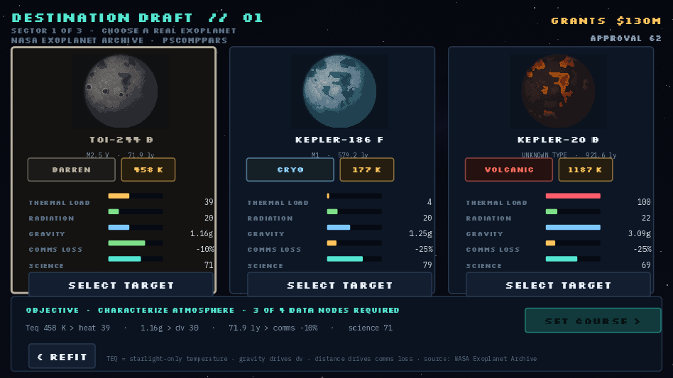
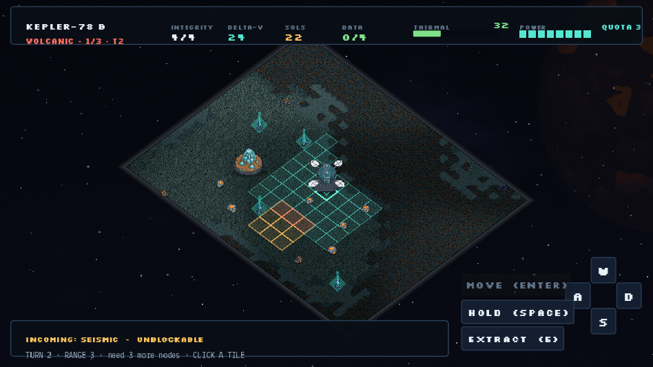
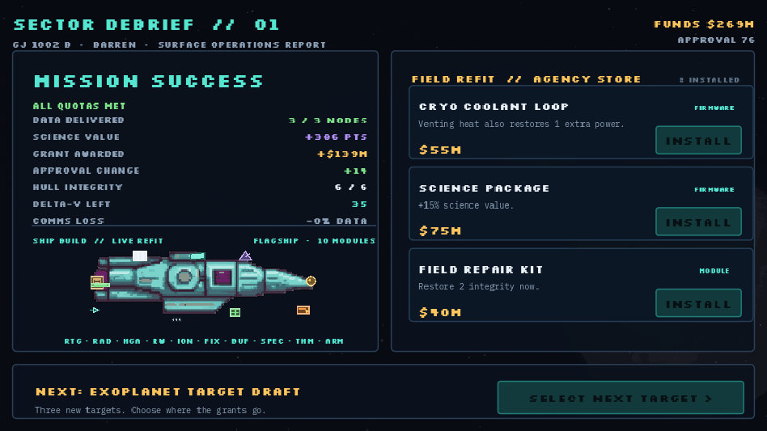
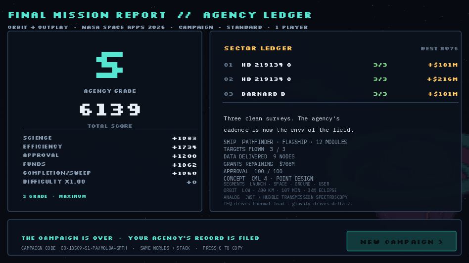
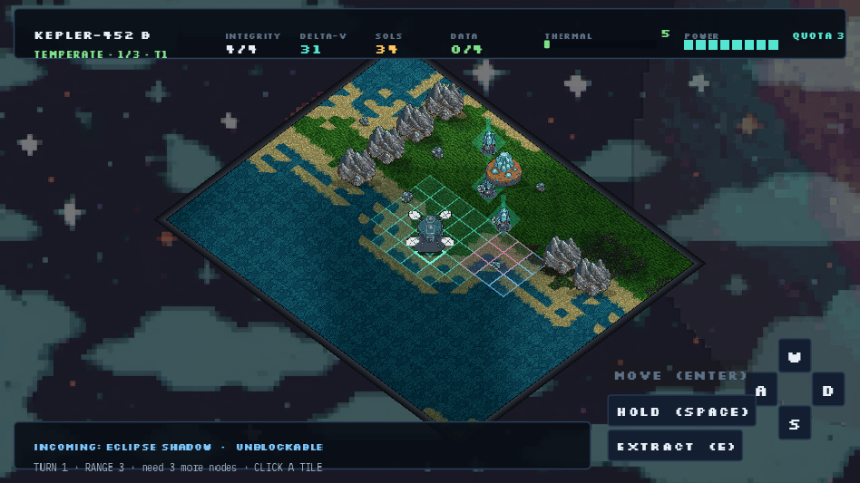
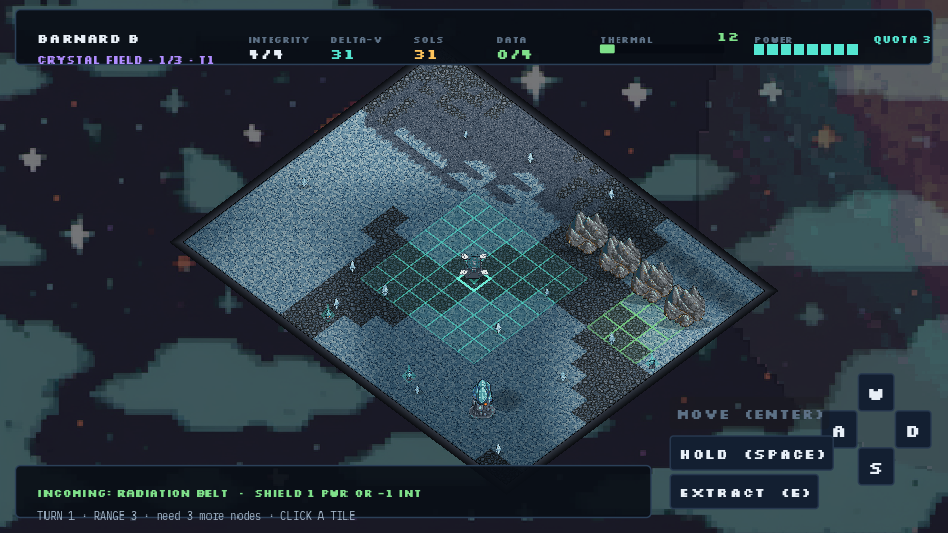
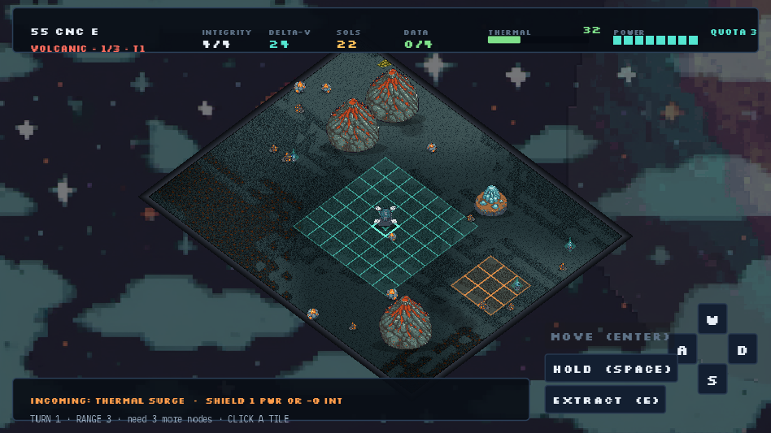
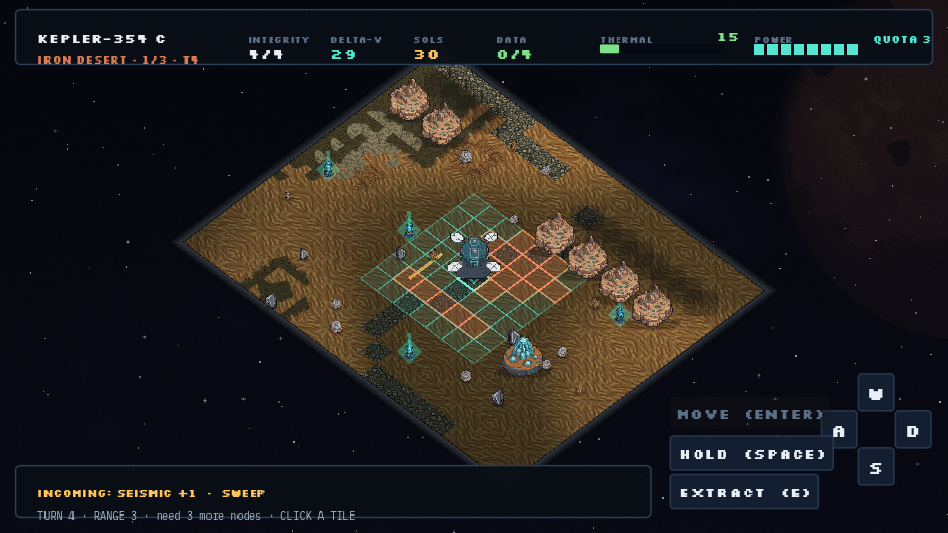

# Orbit & Outplay — Exoplanet Survey

A turn-based **mission-architecture roguelite**. You run a small space agency: build a spacecraft, pick a real exoplanet from the NASA Exoplanet Archive, fly a telegraphed hazard course across its surface, bring the data home, and keep the agency funded long enough to file a campaign record.

Every destination is a real planet. Every hazard is generated from its measured properties — equilibrium temperature, host-star radiation, and the surface archetype derived from its temperature and radius — while distance from Earth drives downlink loss.

- **Engine:** Godot 4.7.2 (GDScript, GL Compatibility renderer)
- **Viewport:** 640×360, pixel art, nearest-neighbour filtering
- **Target:** desktop and browser (WebGL 2, threadless export)
- **Run length:** 3 sectors, roughly 10–15 minutes

**Status:** playable end to end in native Godot — title → mission design → target draft → three surface sectors → debrief → final report. The source, data, and art are in this repository; the web build is produced locally with the Godot 4.7.2 export templates.

---

## What it looks like

**In one sentence:** you design a spacecraft under a fixed budget, draft one of three real exoplanets, then keep it alive long enough to bring the data home.

| | |
|---|---|
|  |  |
| **Pick a real world.** Three archive planets, each with measured properties and five derived mission bars. | **Fly the surface.** One move per turn, telegraphed hazards, and a limited hull. |
|  |  |
| **Spend the grant.** Repair, refit, and buy rule-bending firmware between sectors. | **File the report.** Grade, score breakdown, and the story of what the agency found. |

Each run is three planets. At every stop you draft one of three real archive worlds, pick a route across its surface, and decide when to spend fuel, hold position, or extract before the next hazard lands. Between planets you spend the grant on repairs, instruments, and firmware that bend the rules.

The loop is deliberately short: **build → draft → survive → refit → repeat**, three times, then a final grade. A run takes about 10–15 minutes.

### Surface variety

Every sector is drawn from a different archive world. The surface generator switches landform algorithms per biome, so an ice sheet, a volcanic caldera, a crystal field, and a cratered iron desert each ask for a different route. The current 72-planet pool is made of landable worlds; ocean, methane, obsidian, and carbon are terrain-renderer showcases outside the draft pool.

| | |
|---|---|
|  |  |
| **Ocean terrain.** Island chains, shallow reefs, and long water crossings — a renderer showcase, not a draft destination. | **Frozen worlds.** Fractured ice plates, open cracks, and little cover. |
|  |  |
| **Volcanic worlds.** Lava fields, ash, and thermal vents that punish a slow route. | **Iron deserts.** Crater rims, dust, and long exposed approaches. |

---

## Contents

1. [What it looks like](#what-it-looks-like)
2. [What you actually do](#what-you-actually-do)
3. [A run, step by step](#a-run-step-by-step)
4. [Mission design](#mission-design)
5. [Surface operations](#surface-operations)
6. [Debrief and refit](#debrief-and-refit)
7. [Scoring](#scoring)
8. [Where the science comes from](#where-the-science-comes-from)
9. [Controls](#controls)
10. [Running the project](#running-the-project)
11. [How the code is organised](#how-the-code-is-organised)
12. [The surface generator](#the-surface-generator)
13. [Art pipeline](#art-pipeline)
14. [Working with agents](#working-with-agents)
15. [Repository layout](#repository-layout)
16. [Credits](#credits)

---

## What you actually do

You are not piloting a ship. You are making **engineering trade-offs under a fixed budget**, then living with them on an alien surface.

The loop asks one question over and over: *is this route worth the resources it costs?* A longer path might dodge a thermal surge but drain your delta-v. A shortcut might grab two data nodes but end with the hull on fire. There is no combat AI — the opponent is your own resource budget.

Three ideas hold the design together:

- **Telegraphed hazards, not surprise damage.** Every threat is shown one turn before it resolves. A loss is always explainable: you knew what was coming and chose the route anyway.
- **Real measurements, honest abstraction.** The archive does not publish "heat per move". The game derives a stable, documented value from equilibrium temperature, gravity, insolation, stellar age, and distance — and shows the raw measurement on the card so you can see the abstraction.
- **One screen per decision.** Title → design → draft → surface → debrief → report. No hidden menus, so a run can be demoed in 30 seconds and understood in a few minutes.

---

## A run, step by step

| Phase | What happens | What you decide |
|---|---|---|
| **Title** | Starfield, ringed planet, best score, How to Play overlay | Start a run |
| **Mission design** | Pick a hull, launch vehicle, orbit, science objective, and exactly two instruments | What kind of mission this is |
| **Target draft** | Three real exoplanets are drawn from the archive, each with measured properties and five derived mission bars (thermal, radiation, gravity, comms, science) | Which world to risk |
| **Surface sector** | One move per turn across a chunked alien landscape; hazards telegraph, then resolve at end of turn | Route, when to hold, when to extract |
| **Debrief** | Success/failure review, data delivered, science, grant, approval change, three-offer refit shop | What to spend the grant on |
| **Final report** | Grade C–S, score breakdown, sector ledger, narrative, educational notes | Whether to run again |

The draft is deliberately weighted: one **mild**, one **moderate**, and one **harsh** destination, with distinct biomes, so every choice is a real risk/reward decision.

Approval starts at **62**. A successful sector is worth **8 + 2 per data node collected**; a failed one costs **−24**. If approval hits zero, the agency is defunded and the run ends early — even in sector one.

---

## Mission design

### Budget and mass

- **Budget:** $500M, covering hull, launch vehicle, instruments, and the mission itself.
- **Fairing capacity:** the launch vehicle sets a hard mass ceiling in kilograms.
- Getting the design wrong is not a soft warning: the launch button stays locked until the loadout is valid.
- There is a conservative default loadout (Pathfinder / Vector M / Low orbit / Characterize Atmosphere / Spectrometer + Thermal Imager) so a new player can launch immediately.

### Hulls

| Hull | Class | Mass | Cost | Power | Δv | Integrity | Data | Thermal res. | Move range | Perk |
|---|---|---|---|---|---|---|---|---|---|---|
| **Pathfinder** | General survey bus | 380 kg | $170M | 120 | 30 | 4 | 8 | 4 | 3 | +1 power capacity, no weaknesses |
| **Cryo Surveyor** | Cold-world specialist | 330 kg | $150M | 100 | 34 | 3 | 7 | 12 | 3 | Heat gain ×0.6, thinner hull |
| **Deep Relay** | Data hauler | 560 kg | $210M | 170 | 26 | 4 | 14 | 5 | 3 | +25% grants, −12% comms loss |
| **Hopper** | Light lander | 240 kg | $130M | 80 | 38 | 2 | 6 | 2 | 4 | +8 Δv, two hits and it is over |

### Launch vehicles and orbits

| Vehicle | Cost | Capacity | Note |
|---|---|---|---|
| **Vector L** | $55M | 450 kg | Cheap, tight margin; cannot lift the Deep Relay |
| **Vector M** | $100M | 850 kg | The safe middle |
| **Vector H** | $190M | 1,400 kg | Expensive, room for anything |

Orbit is a mission-profile multiplier rather than a separate orbit-mechanics sim:

| Orbit | Effect |
|---|---|
| **Low** | Balanced, no modifier |
| **Polar** | +15% science, +10% heat per tile |
| **High** | −15% heat per tile, −10% science |

### Objectives

| Objective | Quota | Bonus | Perk |
|---|---|---|---|
| **Characterize Atmosphere** | 3 nodes | +1 power cap | The safest quota |
| **Map the Surface** | 4 nodes | +3 Δv | Needs every node |
| **Search for Biosignatures** | 3 nodes | +1 integrity | Double science on temperate worlds |
| **Survey Planetary Geology** | 3 nodes | — | +25% grants on rocky worlds |

### Instruments (pick exactly two)

| Instrument | Mass | Cost | Power | Effect |
|---|---|---|---|---|
| **Multispectral Camera** | 35 kg | $45M | 12 | +10% science |
| **Spectrometer** | 45 kg | $60M | 18 | +20% science |
| **Radar Sounder** | 30 kg | $50M | 14 | Hazard shielding costs 0 power |
| **Thermal Imager** | 28 kg | $40M | 10 | Heat gain ×0.7 |
| **Magnetometer** | 22 kg | $35M | 8 | +1 power regeneration per turn |
| **Subsurface Drill** | 55 kg | $55M | 16 | Bonus data on rock worlds (arid, barren, volcanic) |

Derived ship stats update live in six telemetry bars: **mass, power, delta-v, hull integrity, thermal margin, and data capacity**. Power regeneration is `1 + instrument bonuses`, plus 1 for a hull generating 150+ power, minus 1 if instrument draw reaches 36.

---

## Surface operations

The surface is one sector of a planet: a chunked 16×16-cell world streamed from a fixed seed, rendered isometrically at the 640×360 logical resolution. Around the map sit the HUD, a route readout, a D-pad, and the three action buttons.

### Resources

| Resource | What it represents | How it changes |
|---|---|---|
| **Integrity** | Structural health | −1 to −2 per hazard hit; zero ends the sector |
| **Thermal** | Heat load | Every path tile adds heat; HOLD vents it; overheating costs integrity |
| **Δv** | Remaining propellant | Each tile moved and some hazards spend it |
| **Power** | Shielding and systems | Regenerates each turn; blocking a hazard costs power |
| **Sols** | Mission clock | One per tile moved (or one HOLD); the sector fails when it runs out |
| **Data** | Collected science nodes | Collect the quota, then extract; a full 4/4 sweep auto-completes the sector |

### The movement rule

Each turn allows **one committed move** of up to 3 tiles (4 in the Hopper, +1 with the Ion Thruster). Moving the cursor over a reachable cell draws the full path and previews its **Δv cost, heat load, node count, and whether the path crosses a hazard**; every tile on that path spends 1 Δv and 1 sol, so a three-tile move costs three of each. Commit the move, then the hazard spawned for this turn resolves at the **end** of the turn. Reaching all four nodes auto-completes the survey; reaching the objective quota and pressing **EXTRACT** banks the data early.

That single rule is what makes the sector a route-planning problem rather than a walking simulator: you cannot creep forward one tile at a time, and you cannot see the next threat until you have spent this turn's move.

### Actions

| Action | Key | Effect |
|---|---|---|
| **Move** | `ENTER` / click the tile again | Commit the previewed path |
| **Hold** | `SPACE` | Stay put, vent heat, regenerate power, spend a sol |
| **Extract** | `E` | Leave the surface; data is banked |
| **Grid** | `G` | Toggle the tile grid overlay |

### Hazards

Hazards are drawn from the planet's physics and are biased toward uncollected data nodes, so the greedy grab is always the risky one. Blockable hazards can be absorbed with power; unblockable ones must be routed around or eaten. Hazards resolve at the **end** of the turn, not when you step on them.

The hazard set **ramps with the mission**: one threat at turn 1, a second from turn 3, a third from turn 6 (or from turn 4 in sectors 2–3). Footprints vary between 3×3 blocks, crosses, diamonds, and five-tile lines. A line marked **SWEEP** moves one tile per turn for four turns, with an arrow showing where it will be next; it can chase you across the map. Damaged ground leaves a visible scar for four turns.

| Hazard | Blockable | Integrity | Thermal | Δv | Other |
|---|---|---|---|---|---|
| **Stellar Flare** | yes | −1 | +8 | — | — |
| **Thermal Surge** | yes | — | +24 | — | — |
| **Dust Storm** | yes | −1 | — | −1 | — |
| **Seismic Shock** | no | −1 | — | — | — |
| **Radiation Belt** | yes | −1 | +5 | — | — |
| **Eclipse Shadow** | no | — | −16 | — | Restores 2 power |
| **Cryo Quake** | no | −1 | — | −1 | — |
| **Solar Wind Front** | yes | — | +15 | −1 | Sweeps in a line |
| **Meteor Shower** | no | −2 | +4 | — | Heavy impact |

The **Radar Sounder** makes blocking free, the **Thermal Imager** cuts heat gain, and the **Magnetometer** speeds power regeneration — the three direct counters to the three ways a sector kills you.

### Sector maths

At the start of a sector, the planet's measured values are converted into run constraints:

- `Δv = round(planet Δv × ship Δv / 30)`
- `sols = max(18, planet sols − 2 × (sector − 1))`
- `heat per move = round(planet heat × 0.11) − thermal resistance`, then hull, orbit, and instrument multipliers, clamped **1–18**
- `comms loss = planet comms loss − hull/instrument bonus`, clamped **0–40%**
- `power cap = 4 + floor(power generation / 40)`, +1 for the atmosphere objective, +1 per later sector

---

## Debrief and refit

After every sector you get a result screen and a **three-offer refit shop**. Modules stack, so a run becomes a build.

| Module | Cost | Kind | Effect |
|---|---|---|---|
| **RTG Auxiliary** | $70M | Module | +1 power regeneration |
| **Deployable Radiator** | $65M | Module | Heat gain −3 per move |
| **Reaction Wheel** | $55M | Module | +4 Δv every sector |
| **Ablative Armor** | $60M | Module | +2 maximum integrity |
| **Deep Data Buffer** | $50M | Module | +4 data buffer, less loss on long links |
| **High-Gain Antenna** | $80M | Module | Comms loss −10% |
| **Science Package** | $75M | Firmware | +15% science value |
| **Salvage Protocol** | $70M | Firmware | +30% grant from every sector |
| **Field Repair Kit** | $40M | Module | Restore 2 integrity (repeatable) |
| **Cryo Coolant Loop** | $55M | Firmware | Venting heat also restores +1 power |
| **Ion Thruster** | $60M | Module | +1 tile movement range per turn |

Grants are `(55 + 28 × delivered data) × grant multiplier`, with a bonus for a full four-node sweep and a further 1.25× for geology objectives on rocky worlds.

---

## Scoring

Final score is a weighted sum, not a single survival check:

| Component | Formula |
|---|---|
| Science | Σ `planet science × ship science multiplier × delivered nodes` |
| Efficiency | Σ `(Δv left × 8) + (integrity left × 55)` on successful sectors |
| Approval | final approval × 12 |
| Funds | remaining budget × 1.5 |
| Completion | 220 per successful sector |
| All-success bonus | +400 for 3/3 |

| Grade | Score |
|---|---|
| **S** | ≥ 5,200 |
| **A** | ≥ 4,000 |
| **B** | ≥ 2,800 |
| **C** | below 2,800 |

This is why the game rewards **efficiency over greed**: arriving home with propellant and hull intact is worth more than a heroic data sweep that ends with a dead lander.

---

## Where the science comes from

The dataset is built from the **NASA Exoplanet Archive — Planetary Systems Composite Parameters (`pscomppars`)** table, which combines the best available parameters for each confirmed planet.

- 72 curated planets, **0.69–2.19 Earth radii** (the builder keeps 0.35–2.2 R⊕; the curated set lands inside that window, where the derived gravity values stay playable).
- 54 host stars, 52 transit and 20 radial-velocity discoveries, 4.2–4,976 light-years out.
- Raw query snapshot: `data/pscomppars_raw.csv` (5,801 rows).
- Curated game set: `data/exoplanets.json` (each entry carries both the **raw measured values** and the derived `game` block).
- Builder: `tools/build_exoplanets.py` — deterministic, so the dataset can be regenerated and diffed.
- Missing or physically implausible masses use the **Chen & Kipping (2017)** mass–radius relation and are flagged `mass_est: true`.

### Fields used

| Archive field | Game use | Unit |
|---|---|---|
| `pl_eqt` (or `pl_insol`) | Equilibrium temperature → heat load, thermal start | K |
| `pl_bmasse` / `pl_rade` | Surface gravity → Δv cost | g (9.80665 m/s²) |
| `pl_insol` | Stellar flux → radiation and science value | W/m² (Earth = 1) |
| `sy_dist` | Distance → comms loss on downlink | pc / ly |
| `st_teff`, `st_spectype` | Star colour and hazard flavour | K / spectral class |
| `pl_orbsmax`, `pl_orbper` | Dossier detail and campaign variety | AU / days |

### Derived rules

```
heat      = clamp((Teq − 140) / 8, 4, 100)
radiation = clamp(12 + 32·(star < 1 Gyr) + 16·(star < 3 Gyr)
               + 14·(Teff > 6200 K) + 8·(Teff < 3900 K)
               + 10·(insolation > 10), 10, 95)
science   = clamp(55 + 28·(180 K ≤ Teq ≤ 330 K) + 16·(radius ≤ 1.65 R⊕)
               + 8·(system ≥ 3 planets) + 6·(4200 K ≤ Teff ≤ 6800 K), 40, 120)
delta_v   = clamp(36 − 2.5·gravity_g − 0.05·heat − 0.08·radiation, 18, 36)
comms_loss = 0 / 5 / 10 / 18 / 25 % at <20 / <50 / <120 / <350 / ≥350 ly
sols      = clamp(34 − |Teq − 280| / 55, 22, 36)
```

The in-game **THERMAL**, **ΔV**, and **COMMS LOSS** values are documented gameplay abstractions, not flight dynamics. The measured archive values themselves are shown on the detail line of every draft card.

### Mission-design framework used

The challenge resource tab maps directly onto the design loop:

- **Design and Develop Science Missions** — the game shows the four mission segments explicitly: launch (vehicle), space (hull + payload), ground (downlink/comms loss), and user (science objective).
- **GMAT** — orbit choice (LOW/POLAR/HIGH) is translated into altitude, period, eclipse fraction, and passes/day; the final report prints the flown profile.
- **Concept Maturity Levels (CMLs)** — the design validation line reports CML 1 CONCEPT, 2 FEASIBILITY, 3 TRADE STUDY, or 4 POINT DESIGN from mass margin, power margin, and science traceability.
- **Mission Design Lab (MDL)** — mission design is staged as a trade study, then a point design; the between-sector refit is the redesign loop.
- **Mission Viz** — the orbit profile in the final ledger connects the surface run to the orbital geometry that enabled it.
- **A Learning Game About Telescopes** — an instrument family that matches the objective earns a **science fit +10%** bonus; a mismatched payload is legal but loses science return.
- **CubeSat 101** — the run is a compressed ConOps: design, launch, insertion, surface operations, downlink, end of mission, with mass/power/thermal/data/budget as the budget lines.
- **CSA digital games** — short browser runs, readable HUD, and explicit feedback keep the game pick-up-and-play.

Source: <https://exoplanetarchive.ipac.caltech.edu/> — NASA Exoplanet Archive, California Institute of Technology, operated under contract with NASA.

---

## Controls

| Action | Input |
|---|---|
| Move the path cursor | `WASD`, arrow keys, or the on-screen D-pad |
| Preview a route | Move the cursor onto a reachable tile |
| Commit the move | `ENTER` / **MOVE**, or click the selected tile again |
| Hold position (vent heat, recharge, end turn) | `SPACE` / **HOLD** |
| Extract from the surface | `E` / **EXTRACT** |
| Toggle grid overlay | `G` |
| Cycle map view (three-quarter / isometric / top-down) | `V` |
| Open How to Play (title screen) | `H` / **HOW TO PLAY** |
| Screenshot (development) | `F10` on map-generation screens (not yet wired in-sector) |
| Everything else | Mouse or touch |

The browser build is fully playable with mouse or touch. Landscape is recommended.

---

## Running the project

### Native

```bash
git clone https://github.com/g1gowda123/spacegame.git
cd spacegame
godot --path .
```

Requires **Godot 4.7.2** (the project targets the `4.7` feature set and the GL Compatibility renderer).

Useful development entry points:

```bash
# Jump straight to a screen for review
godot --path . -- --screen=design
godot --path . -- --screen=sector --capture

# Headless parse/smoke test
godot --headless --path . --quit-after 8

# Regenerate the exoplanet dataset from the raw archive CSV
python3 tools/build_exoplanets.py
```

### Web export

The project is configured for a **static, threadless WebGL 2 build**:

1. Install the Godot export templates for 4.7.2.
2. Open the project, then **Project → Export → Web → Export Project**.
3. Serve the output over HTTP (WebGL cannot load from `file://`):

```bash
cd build/web
python3 -m http.server 8060
# open http://localhost:8060
```

The export is purely static, so it also runs on GitHub Pages, itch.io, or any plain HTTP host. No server-side code, no cross-origin isolation headers required.

---

## How the code is organised

`GameState` is the single source of truth. Every scene reads it, mutates it through methods, and redraws when its `changed` signal fires.

| Path | Responsibility |
|---|---|
| `scenes/title.tscn`, `scripts/title.gd` | Title, how-to-play overlay, best score |
| `scenes/design.tscn`, `scripts/design.gd` | Hull, launch vehicle, orbit, objective, instruments, live telemetry |
| `scenes/draft.tscn`, `scripts/draft.gd` | Three-planet target draft and hazard preview |
| `scenes/sector.tscn`, `scripts/sector.gd` | Surface sector: path planning, hazards, HUD, extraction |
| `scenes/debrief.tscn`, `scripts/debrief.gd` | Result review and refit shop |
| `scenes/report.tscn`, `scripts/report.gd` | Campaign ledger, grade, score breakdown |
| `scripts/game_state.gd` | Run state, mission rules, economy, scoring |
| `scripts/ui_kit.gd` | Shared pixel-UI helpers (panels, bars, labels, buttons) |
| `scripts/ship_diagram.gd` | Procedural spacecraft diagram |
| `scripts/space_backdrop.gd` | Starfield / planet backdrop renderer |
| `scripts/map_generator.gd` | Chunked terrain generator and renderer |
| `shaders/` | Backdrop and map post-processing shaders |

Autoloads: `GameState` (rules and state), `DevRouter` (CLI screen selection and capture), `CaptureProbe` (screenshot helper).

**State flow.** `new_run()` seeds a campaign and rolls the first draft. Design selections mutate `run`; `ship()` folds hull, vehicle, orbit, objective, instruments, and owned modules into a single derived stats dictionary. `begin_sector()` converts a planet into sector constraints. `finish_sector()` settles data delivery, science, grants, and approval. `calculate_score()` walks the history at the end.

Nothing is persisted except the local best score (`user://orbit_save.cfg`). Runs are short by design.

---

## The surface generator

The sector renderer is the largest system in the project and the reason the game looks like a place rather than a board.

- **Chunked streaming:** 16×16-cell chunks, only the visible window is drawn.
- **13 terrain biomes:** temperate, arid, cryo, volcanic, ocean, barren, methane lakes, iron desert, sulfur plains, crystal field, obsidian glass, ammonia ice, carbon world. Nine are landable in the current planet pool (temperate, arid, cryo, volcanic, barren, iron, sulfur, crystal, ammonia); ocean, methane, obsidian, and carbon are generator set-pieces that no curated planet currently selects. Each biome declares its own generator archetype — continents, dunes, fractured ice, caldera, archipelago, craters, faceted crystal — plus its own tile keys, tints, props, and life status.
- **Terrain and transitions:** palette-locked 64×64 tiles with per-material edge bands (98 transition pairs), corner matching, shoreline rings, and a roughness mask so coastlines alternate between clean and frayed stretches.
- **Structures and props:** multi-tile natural landmarks (2×2 or 3×3) and biome-specific ambient props, both placed deterministically from the world seed.
- **Projection:** the same world renders in three modes — three-quarter tilt, isometric, and top-down — with a tunable shader for lighting and grain.
- **Determinism:** a seed reproduces the whole map. The CLI can capture any seed, biome, and view.

---

## Art pipeline

All terrain, props, and illustrations are **original pixel art**, generated from diffusion models and then forced into a consistent palette.

1. Generate a source image for a subject.
2. Downscale with nearest-neighbour and palette-lock it to the biome's 16–21 colour palette (`tools/palettes.json`).
3. Heal tile seams with a 1-pixel band, so repeated tiles stay continuous.
4. Author multi-tile structures on transparency with no baked shadow — the renderer owns the contact shadow and lighting.
5. Drop the 64×64 (or 128/192) result into `assets/tilesets/`, `assets/props/`, `assets/tilesets/structures/`, or `assets/sprites/`.

Scripts and palettes live in `tools/`. The pipeline is documented in `assets/tilesets/README.md`.

---

## Working with agents

This project was built with a small team of LLM agents sharing one working tree, coordinated through files instead of chat:

| File | Purpose |
|---|---|
| `AGENTS.md` | Read order, file ownership, hard constraints, useful commands |
| `docs/WORKLOG.md` | Append-only log: what changed, what was tried, what failed |
| `docs/TASKS.md` | Task board with owners, status, and open art requests |
| `docs/ART_PIPELINE.md` | Tile generation rules, palette locking, seam healing |
| `docs/MAP_GENERATOR.md` | Generator architecture, controls, CLI flags |

The parts that made it work: a single append-only work log, a task board agents claim from before starting a multi-file change, and hard constraints written down (engine version, viewport size, palette rules) so a fresh agent can be dropped in without re-deriving the project.

**Attribution:** every image was generated by the **user** in ComfyUI (SDXL Base 1.0 + Pixel Art XL) on the local machine — prompts, seeds, and accept/reject decisions are theirs. The agents wrote the generation and pixelisation scripts, integrated the outputs into the game, and wrote the code.

---

## Repository layout

```
.
├── project.godot          # Godot project config (640×360, GL Compatibility)
├── scenes/                # Title, design, draft, sector, debrief, report
├── scripts/               # GDScript: state, rules, UI, generator
├── shaders/               # Backdrop and map shaders
├── assets/
│   ├── tilesets/          # 64×64 terrain tiles, transitions, and landmark structures
│   ├── sprites/           # Ships, planets, UI art
│   ├── props/             # Small environmental accents
│   ├── backgrounds/       # Space plates
│   ├── audio/             # UI and alert sounds
│   ├── ui/                # Fonts (SIL OFL) and UI art
│   └── raw/               # 1024 px generation sources (local only)
├── data/
│   ├── exoplanets.json    # 72 curated planets + derived game values
│   └── pscomppars_raw.csv # Raw NASA Exoplanet Archive query snapshot
├── docs/                  # Agent workflow, art pipeline, generator notes
├── screenshots/           # Screenshots used by this README
├── AGENTS.md              # Working agreement for agents
└── tools/                 # Dataset builder and art pipeline scripts
```

---

## Credits

- **Game code and original art:** built for the NASA Space Apps Challenge 2026, *Space Mission Design Game*.
- **Image generation:** all diffusion art was run by the user in ComfyUI (SDXL Base 1.0 + Pixel Art XL). Prompts, seeds and selection are the user's; the agents wrote the pipeline scripts and integrated the results.
- **Data:** NASA Exoplanet Archive, *Planetary Systems Composite Parameters* (Caltech, under contract with NASA). Public domain / NASA open data.
- **Mass–radius relation:** Chen & Kipping (2017), *Probabilistic Forecasting of the Masses and Radii of Other Worlds*.
- **Fonts:** Silkscreen and IBM Plex Mono, both under the SIL Open Font License. Licence files are in `assets/ui/`.
